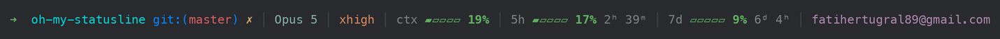
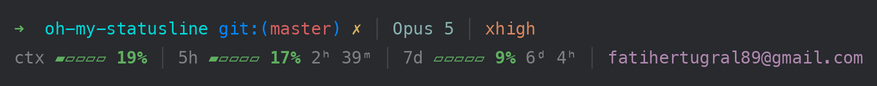

# oh-my-statusline

oh-my-zsh (robbyrussell) flavored status line for Claude Code.



Everything on one line when the terminal is wide enough.



When it isn't, the bars wrap onto a second row instead of being cut off.

The percentage is the loud part of a bar — bold, in the level color — with the
label dim and the reset countdown quieter still: its unit letters are modifier
letters (`1ʰ 56ᵐ`), which the font draws small, since a terminal has no font
size to shrink. On narrow terminals the account shortens and then drops, the
bars wrap onto a second row, then narrow, then lose their glyphs — reset
countdowns stay visible to the end.

| Segment | What it shows |
| --- | --- |
| `➜ dir git:(branch) ✗` | cwd + git branch, classic robbyrussell colors (`✗` = dirty) |
| `Opus 5` | active model |
| `high` | reasoning effort level |
| `ctx ▰▰▱▱▱ 33%` | context window fill |
| `5h ▰▰▰▱▱ 45% 1ʰ 56ᵐ` | Claude plan 5-hour session limit — bar = used %, right = time until reset |
| `7d ▰▱▱▱▱ 25% 5ᵈ 13ʰ` | Claude plan weekly limit — same, weekly window |
| `you@example.com` | account this session is signed in as (trails the line) |

Plan usage is read from the native `rate_limits` field Claude Code passes to
status lines (same data as `/usage`) — no external tools, no network calls,
~30 ms per render. Bar colors go calm green → soft gold → terracotta as a limit
fills up; the palette is deliberately muted (never red) because these colors sit
on screen all day next to the text.

The account comes from the local Claude Code config
(`~/.claude.json`, or `$CLAUDE_CONFIG_DIR/.claude.json`) — a file read, nothing
is sent anywhere. Set `OMS_ACCOUNT=user` for just the local part, or
`OMS_ACCOUNT=off` to hide it (e.g. while screen sharing).

## Requirements

- macOS or Linux (Windows not supported)
- `bash` 3.2+ (macOS stock bash works) and `jq`
- A font with `➜ ▰ ▱ │ ✗` and the modifier letters `ʰ ᵐ ᵈ` (any Nerd Font or
  modern terminal font)

## Install

One-liner (oh-my-zsh style — clones to `~/.oh-my-statusline`):

```sh
sh -c "$(curl -fsSL https://raw.githubusercontent.com/FatihErtugral/oh-my-statusline/master/install.sh)"
```

Or from a clone:

```sh
git clone https://github.com/FatihErtugral/oh-my-statusline.git
cd oh-my-statusline && ./install.sh
```

`install.sh` updates the clone, backs up `~/.claude/settings.json`, merges the
`statusLine` entry in (all other keys preserved), smoke-tests the script, and
shows a sample render.

## Updating

Re-run the installer — the same command either way, on macOS and Linux:

```sh
sh -c "$(curl -fsSL https://raw.githubusercontent.com/FatihErtugral/oh-my-statusline/master/install.sh)"
```

It also updates itself in the background at most once a day, oh-my-zsh style.
Both paths go through `scripts/update.sh`, which never gets stuck on a conflict:

- **`~/.oh-my-statusline`** (the managed install) always ends on origin's tip.
  If the clone was dirty or had diverged, the local diff is saved to
  `.oms-backup/local-<timestamp>.patch` first, then the clone is reset — a plain
  `git pull --ff-only` used to just fail here and leave installs stale forever.
- **A dev checkout elsewhere** is only fast-forwarded, and left completely alone
  when it is dirty or diverged — pass `--force` to reset it onto origin anyway.
- **A plugin install** (`/plugin install`) is left to Claude Code; update it
  with `/plugin update`.

`./install.sh --no-update` installs without touching git at all.

### As a Claude Code plugin

```
/plugin marketplace add FatihErtugral/oh-my-statusline   # or a local path
/plugin install oh-my-statusline@oh-my-statusline
/oh-my-statusline:install
```

### Manual setup

```json
"statusLine": {
  "type": "command",
  "command": "bash /absolute/path/to/oh-my-statusline/scripts/statusline.sh"
}
```

## Settings

All optional, read from the environment Claude Code runs the status line in
(`env` in `settings.json`, or your shell profile):

| Variable | Default | Effect |
| --- | --- | --- |
| `OMS_ACCOUNT` | `email` | `email` \| `user` (local part only) \| `off` |
| `OMS_DIR` | `~/.oh-my-statusline` | where the managed clone lives |
| `OMS_REPO` | GitHub HTTPS URL | clone source for the installer |
| `OMS_NO_UPDATE` | `0` | `1` disables the installer's git update step |

## Notes

- `rate_limits` is only present for Claude subscription plans and appears
  after the first API response — the usage bars simply stay hidden until then.
- Every numeric is validated before rendering; malformed payloads degrade to
  fewer segments, never garbage output.
- Responsive layout reads the terminal width from `$COLUMNS` (exported by
  Claude Code v2.1.153+; `/dev/tty` fallback, then 80). Tiers: one line →
  account shortened → account dropped → bars on a second row → narrower bars →
  bar glyphs dropped → countdowns dropped, in that order.
